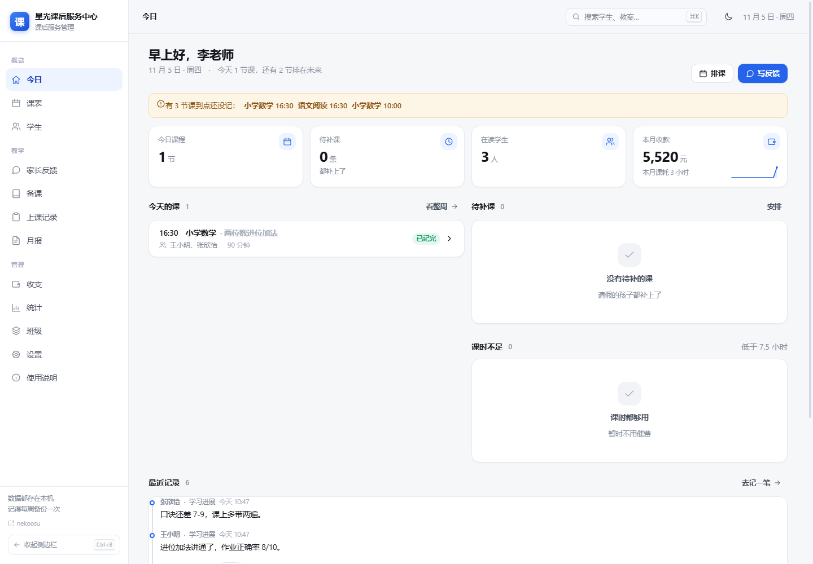
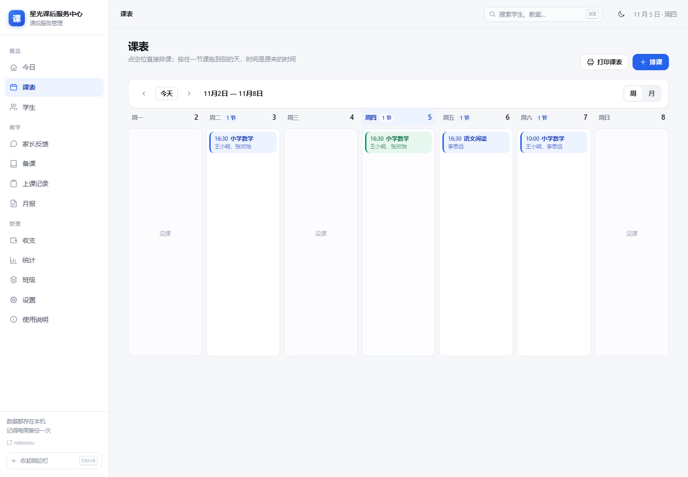
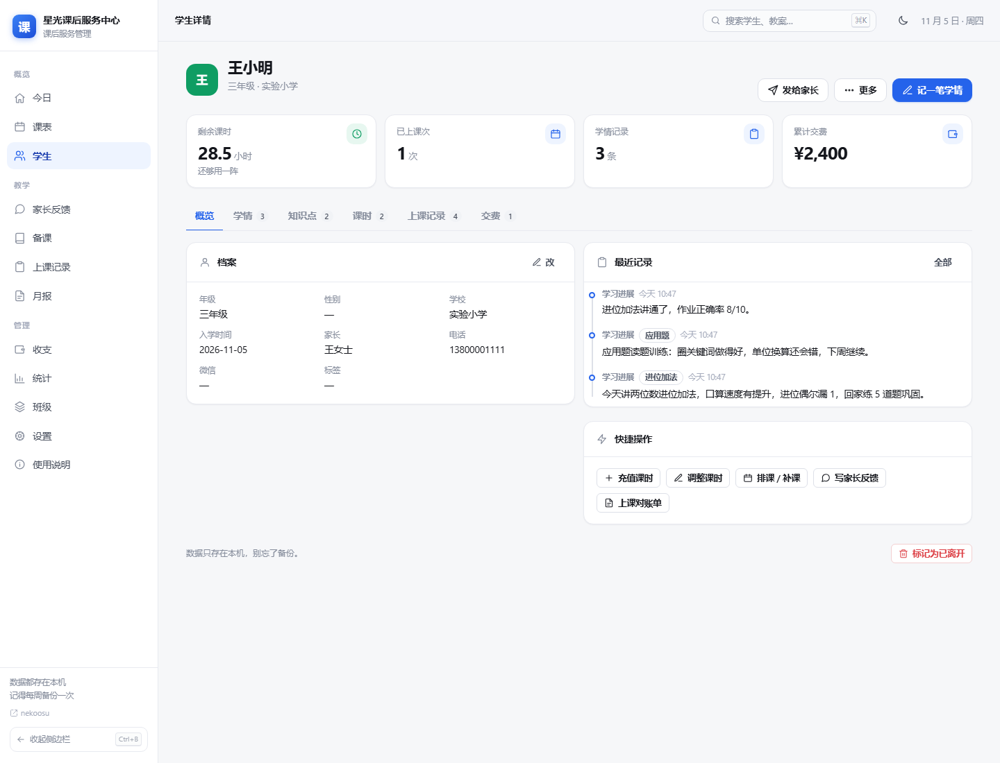
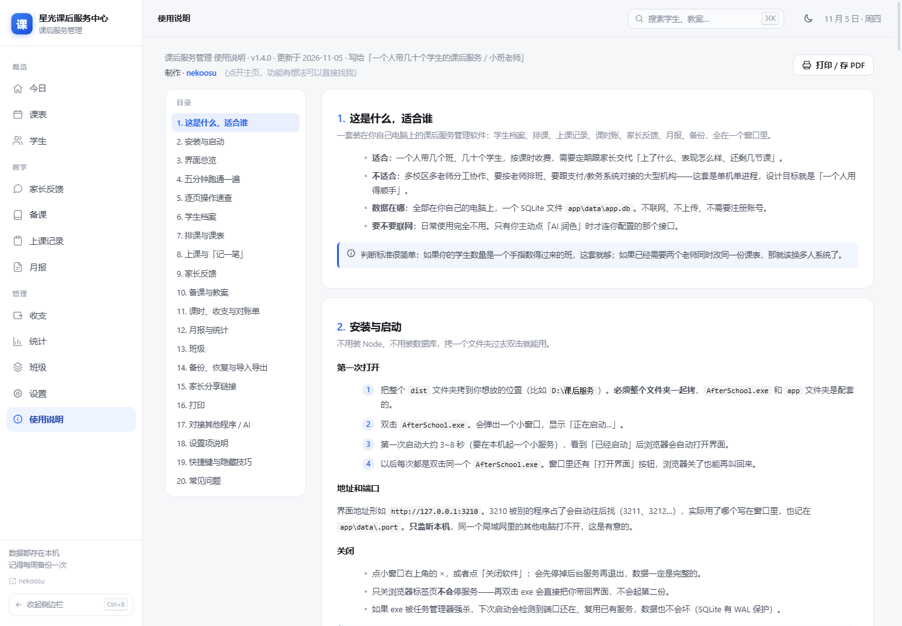
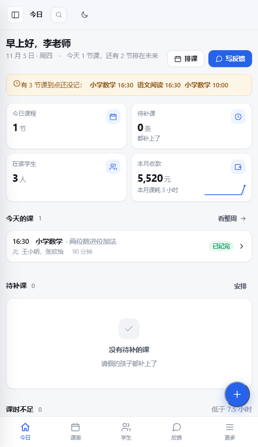

# 课后服务管理

一套装在自己电脑上的课后服务 / 小班教学管理系统：学生档案、排课、上课记录、课时账、家长反馈、月报、备份，全在一个窗口里。

不用装数据库，不用联网，不用注册账号——双击一个 exe 就能用，数据是本地一个 SQLite 文件。



## 适合谁

- 一个人带几个班、几十个学生，按课时收费，需要定期跟家长交代「上了什么、表现怎么样、还剩几节课」的老师。
- 想在自己电脑上管账、又把数据留在手里的小机构。

**不适合**：多校区、要角色权限与审批流、要跟支付/教务系统重度集成的大型机构。这套是**单机单进程**，设计目标就是「一个人维护、几个人用」——可以登记多位老师、分别看各自的课表，但没有登录和权限分级。

## 功能

| 模块 | 能做什么 |
| --- | --- |
| **今日** | 首页大卡：问候 + 今天几节课 + **本周每天的课量柱状图**，下面六格快捷入口（排课 / 记录 / 收款 / 反馈 / 学生 / 月报）；谁课时快用完、谁最近没说过话，一屏看完。大卡跟随主题：浅色是浅底深字，深色才是深卡 |
| **课表** | 周视图拖拽换天、一键排重复课（按周展开 1~26 周）、冲突预检（学生 + 老师）、一键补课、**复制到下周**、**导出 .ics 到手机日历**、按老师筛选、打印一页一周 |
| **学生** | 档案、标签、课时流水、学情记录、知识点、**多科课表**、上课与交费历史、月度对账单 |
| **老师** | 登记老师（科目/电话/标记色/任教课程），看每位老师的本周课量，老师不能被同时排两节 |
| **记一笔** | 一节课一次记完：谁到了、讲了什么、扣几课时、收多少钱（**课消**单价四级自动匹配），留什么学情 |
| **家长反馈** | 下课逐生生成反馈草稿（取教案要点，可选 AI 润色，三档语气），批量生成、复制发送 |
| **备课** | 教案用 Markdown 写，可让 AI 出初稿，记一笔时自动带出要点 |
| **上课记录** | 按日期/学生/课程/状态筛选，出勤率、明细、导出 CSV |
| **月报** | 按孩子看本月节数/出勤/消耗课时/收款，导出 CSV，能打印 |
| **收支** | 收款台账、课时充值、退费调整 |
| **统计** | 26 周热力图、收入趋势、课时消耗 |
| **班级** | 固定班一次排一整批 |
| **家长分享** | 给单个学生生成只读链接（含本月小结、下次上课、最近反馈），不含电话和金额 |
| **备份** | 每天自动备份 + 手动备份，每份可恢复 / 下载 / 删除 |
| **对接** | 令牌保护的 `/api/v1/*` 只读接口 + 接口文档页，给别的程序或 AI 用 |
| **使用说明** | 内置 21 章操作手册，能打印也能存 PDF |
| **省心的小东西** | 顶栏 ＋ 快速新建（排课/记一笔/收钱/加学生）、主题**点一下就切**浅色深色（想跟着系统走：设置 → 外观）、`?` 快捷键说明、设置页**数据体检**（查漏记、重名、没挂老师的课）、**查新版本**、今日页一键复制催费话术、窄窗口自动两列课表 + 表格横滚、打印永远黑字白底 |
| **像个软件** | 侧栏与标题栏连成一整块（54px）、当前页左侧一道竖条、折叠后悬停浮出页面名、手机抽屉拉开锁背景滚动、AI 模型名从下拉里选 |
| **独立的窗口** | 1.8.0 起不再是「Edge 开个窗口」：有自己的图标、标题栏和任务栏名，窗口大小和位置记住，打印弹系统打印预览，外链用浏览器打开 |

<table>
<tr>
<td></td>
<td></td>
</tr>
<tr>
<td></td>
<td></td>
</tr>
</table>

## 直接使用（不用装任何东西）

**下载**：[最新版本](https://github.com/Nekoosu/after-school/releases/latest)

- Windows：拿 `after-school-<版本号>.zip`（例如 `after-school-1.8.0.zip`）

**Windows**

1. 解压到任意目录（比如 `D:\课后服务`），里面是 `AfterSchool.exe`、`app\`、`使用说明.txt` 三样，缺一不可、要放在一起。
2. 双击 `AfterSchool.exe`。先弹出一块深色的**启动画面**（图标、标题、一条来回扫的进度条，它在动就说明服务还活着），几秒后淡出，然后出现**一个没有地址栏、没有标签页的窗口——那就是软件本身**（不是浏览器）。把窗口关掉就等于退出：它会先把数据写盘、再留一份自动备份，后台服务一起停。
3. 数据在 `app\data\app.db`，备份在 `app\backups\`，整个目录拷走就是完整迁移。

只监听 `127.0.0.1`，同一局域网的其它电脑打不开——这是有意的。

## 从源码运行

```bash
pnpm install
pnpm dev          # http://localhost:3000
```

```bash
pnpm build
pnpm test         # 43 个单元测试
```

打包成免安装桌面版：

```powershell
# Windows：产出 dist\AfterSchool.exe + dist\app\（约 415 MB）
powershell -ExecutionPolicy Bypass -File scripts\package.ps1
```

## 发布（版本号与压缩包命名）

版本号只改一处：`src/lib/version.ts` 的 `APP_VERSION`。打包后按 `项目名-版本号.zip` 命名，
**本地压缩包统一放 `release\windows\`**，例如：

```powershell
powershell -ExecutionPolicy Bypass -File scripts\package.ps1
Compress-Archive -Path dist\* -DestinationPath release\windows\after-school-1.8.0.zip
```

然后传到 GitHub Releases，tag 用 `v1.8.0`、文件名按 `项目名-版本号.zip`：
Windows 是 `after-school-1.8.0.zip`。
以后每个版本都按这套命名，下载链接永远指向 [releases/latest](https://github.com/Nekoosu/after-school/releases/latest)。

## 技术栈

- **Next.js 15** App Router + **React 19**，页面全部客户端渲染，接口全部 `force-dynamic`
- **SQLite**（better-sqlite3），14 张表 + 2 个视图，课时用流水账（`hours_ledger`），余额永远是 `SUM(delta_minutes)`；`synchronous=FULL`，断电或强杀都不丢已提交的数据
- **手写 CSS** 设计系统（约 4690 行，30 个分区），无 UI 库、无 Tailwind、无 ORM
- 51 个接口、20 个页面、43 个单元测试、434 项接口冒烟、121 项真实浏览器点击检查

## 目录

```
src/app/          页面 + /api 路由，一页一目录、一接口一文件，页面全部 "use client"、路由全部 force-dynamic
src/components/   AppShell（侧栏/顶栏/抽屉/FAB）、手写组件库 ui.tsx、63 个内联 SVG 图标
src/db/           建表 DDL（13 表 2 视图）、行类型定义、SQLite 连接与 WAL/补列/事务
src/lib/          纯逻辑与工具：课时账、冲突检测、报表文案、备份恢复、CSV/Markdown、分享令牌、手册正文
tests/            node:test 单元测试，只测纯函数（不碰数据库）
scripts/          smoke2~15 接口冒烟、ui-check 点击回归、无头浏览器截图、package.ps1 打包
launcher/         C# 5 桌面启动器源码（起服务 + 用 Edge --app 开应用窗口 + 关窗即退） + 随包发给用户的纯文本《使用说明》
docs/screenshots/ README 里用的五张界面图（1440px 与 520px 两种宽度）
public/           图标、manifest.json、Service Worker
```

每个目录里都有自己的 `README.md`，说明「这个目录放什么、新东西该加在哪个文件」。进目录就能看到。

## 数据与备份

- 数据库：`data/app.db`（开发时）；打包版在 `app\data\app.db`
- 备份：`backups/`，文件名 `auto-YYYY-MM-DD-HHMMSS.db` / `manual-…`，保留最近 30 份
- 设置页可一键备份 / 恢复 / 下载 / 删除，恢复前会自动存一份当前快照
- 还能导出全部数据 JSON、按模块导出 CSV、导入学生/教案/班级

## 对接其他程序

设置 → 「对接与接口」生成令牌后，用 `Authorization: Bearer <令牌>` 访问：

```bash
curl http://127.0.0.1:3210/api/v1/summary -H "Authorization: Bearer as_xxx"
```

`/api/v1/summary`、`/api/v1/students`、`/api/v1/students/{id}`、`/api/v1/lessons`、`/api/v1/notes`（只读为主，可建学生、写学情）；`/api/health` 与 `/api/version` 不需要令牌。软件内 `/docs` 有完整文档和 JS/Python 示例。

## AI 润色实测（1.6.0）

对 OpenAI 兼容接口实测过（以共享中转站 `ai.oaea.cn` 为例）：

- 「自动获取」能列出模型并回填；生成前会先探活，失败时明确报错。
- 共享接口排队时**一篇文章 30~120 秒很正常**，个别时候上游直接 504；按钮转圈就是在等，失败会**自动退回本地草稿**，已经写的内容不受影响。
- 推理型模型 `max_tokens` 给小了会返回空正文，程序会自动加大字数重试一次。
- 实测可用与否取决于接口方：当时只有 `tierflow` / `tierflow_pro` 两个模型在线，其余模型池 503。哪个能用以点「自动获取」后实际生成为准。

## 开发约定

见 [AGENTS.md](AGENTS.md)：一文件一职责、能不加表就不加、重复逻辑进 `src/lib/`、每批改动跑 `tsc --noEmit` + `next build` + 冒烟 + 点击检查。

## 许可

[MIT](LICENSE) © 2026 [nekoosu](https://github.com/Nekoosu)
